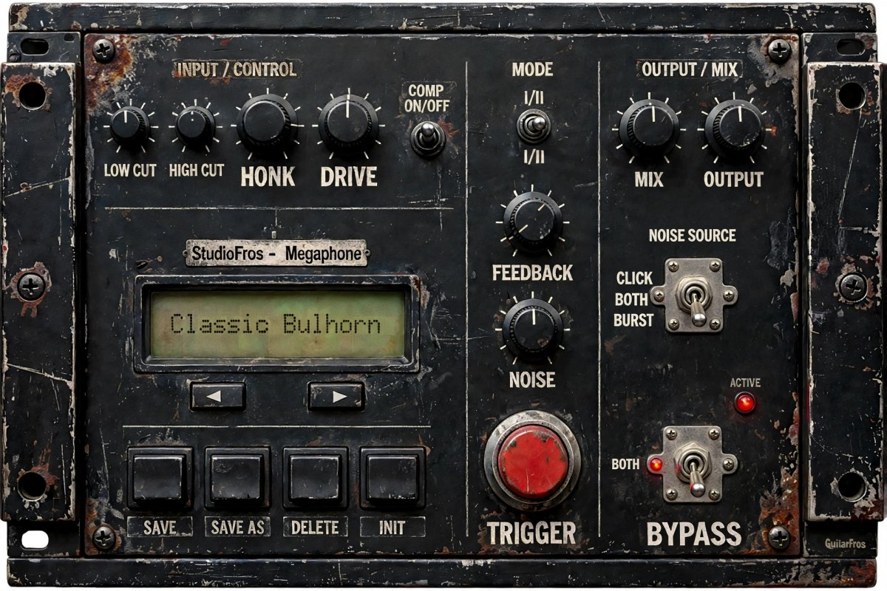

# StudioFros - Megaphone

A free **bullhorn / PA loudspeaker** effect plugin by **GuitarFros**.
Makes any source (voice, guitar, bass, drums...) sound like it is coming out of a megaphone.



- Formats: **VST3** and **Standalone**
- Platforms: **Linux, Windows, macOS** (universal: Apple Silicon + Intel)
- 12 factory presets + your own user presets
- Free and open source ([AGPLv3](LICENSE))

> Status: **v0.1** – first public version. Tested by the author on Linux with REAPER. The Windows and
> macOS builds are produced automatically by GitHub Actions and have not been tested by hand yet:
> reports are very welcome (see *Issues*).

## Controls

### Knobs

| Control | What it does | Range |
|---|---|---|
| **DRIVE** | Saturation of the cheap amplifier | 0 – 100 % |
| **LOW CUT** | Low corner of the band-pass (thin, tinny sound) | 200 – 1000 Hz |
| **HIGH CUT** | High corner of the band-pass | 2 – 8 kHz |
| **HONK** | Horn resonance, 1.5 – 2.5 kHz (the "megaphone" nasal tone) | 0 – 100 % |
| **FEEDBACK** | Slapback echo. Above ~50 % the speaker/microphone loop starts to squeal while there is signal | 0 – 100 % |
| **NOISE** | Level of the loudspeaker noise | 0 – 100 % |
| **MIX** | Dry / wet | 0 – 100 % |
| **OUTPUT** | Output level | -24 – +12 dB |

### Switches

| Control | What it does |
|---|---|
| **MODE I / II** | Two loudspeaker models. **I**: plastic hand-held bullhorn (narrow, harsh, resonant). **II**: PA horn (wider, fuller, slightly longer echo) |
| **NOISE SRC** | `CLICK` (microphone-button click only), `BOTH`, `BURST` (loudspeaker hiss only; follows the input level) |
| **TRIGGER** | Momentary button: plays the microphone-button click (uses the NOISE level) |
| **COMPRESSOR** | Compressor placed *before* the distortion |
| **BYPASS / POWER** | Effect on/off (with a short crossfade). Turning the effect on also plays the button click |

### Signal flow

```
in -> compressor -> HP 24 dB/oct -> LP 24 dB/oct -> HONK peak -> DRIVE (asymmetric tanh)
   -> post low-pass + DC block -> slapback echo (FEEDBACK) -> + noise -> MIX -> OUTPUT
```

## Presets

The preset panel has a name display with a drop-down list (Factory / User), `<` `>` buttons,
**SAVE**, **SAVE AS**, **DELETE** and **INIT**.

- Factory presets are built in and read-only.
- Click the display to open the preset list; `<` `>` step through the presets.
- **SAVE AS** replaces the display with a text field: type the name and press Enter (Esc cancels).
- **SAVE** overwrites the current user preset (on a factory preset it asks for a name instead).
- **DELETE** asks for a second click to confirm (it is dimmed on factory presets).
- A `*` after the name shows that the sound differs from the saved preset.
- Turn a knob and the display briefly shows its name and value. Double-click a knob to reset it.
- The current sound is also stored inside your DAW project.

User presets are small `.sfpreset` (XML) files that you can copy and share:

| OS | Folder |
|---|---|
| Windows | `%APPDATA%\GuitarFros\StudioFros Megaphone\Presets` |
| macOS | `~/Library/Application Support/GuitarFros/StudioFros Megaphone/Presets` |
| Linux | `~/.config/GuitarFros/StudioFros Megaphone/Presets` |

## Install

Download the zip for your system from the **Releases** page and copy the `.vst3` to:

| OS | VST3 folder |
|---|---|
| Windows | `C:\Program Files\Common Files\VST3\` |
| macOS | `~/Library/Audio/Plug-Ins/VST3/` (or `/Library/Audio/Plug-Ins/VST3/`) |
| Linux | `~/.vst3/` |

Then rescan plugins in your DAW (in REAPER: *Options > Preferences > Plug-ins > VST > Re-scan*).
The `Standalone` folder contains a stand-alone application.

The builds are **not code-signed**, so your OS may warn you:

- **macOS**: if Gatekeeper blocks it, run `xattr -dr com.apple.quarantine "StudioFros - Megaphone.vst3"`
  (same for the `.app`), or right-click > Open.
- **Windows**: SmartScreen may show "unknown publisher" for the standalone `.exe`: *More info > Run anyway*.

## Build from source

Requirements: CMake 3.22+, a C++17 compiler (GCC/Clang/MSVC) and Git.
JUCE 8 is downloaded automatically.

```bash
# Linux (Ubuntu/Debian) – system libraries needed by JUCE
sudo apt install build-essential cmake git libasound2-dev libx11-dev libxext-dev \
  libxinerama-dev libxrandr-dev libxcursor-dev libfreetype-dev libfontconfig1-dev \
  libgl1-mesa-dev libcurl4-openssl-dev

cmake -S . -B build -DCMAKE_BUILD_TYPE=Release
cmake --build build --config Release --parallel
ctest --test-dir build -C Release --output-on-failure     # DSP unit tests
```

The results are in `build/StudioFrosMegaphone_artefacts/`. On Linux and macOS the VST3 is also copied to your
user plugin folder (`~/.vst3`, `~/Library/Audio/Plug-Ins/VST3`) automatically; use
`-DMEGAPHONE_INSTALL_AFTER_BUILD=OFF` to disable that.

The audio engine (`Source/MegaphoneDSP.*`) has no JUCE dependency, so the tests can be built alone
with `-DMEGAPHONE_BUILD_PLUGIN=OFF`.

### Releases with GitHub Actions

Every push builds Linux, Windows and macOS and runs the tests; the zips are available as workflow artifacts.
To publish a release, create a tag:

```bash
git tag v0.1.0
git push origin v0.1.0
```

The workflow builds everything and attaches the three zips to a new GitHub Release.

## Interface artwork

The interface is the designer's panel picture (`Design/panel_original.jpg`, 1920 x 1280).
Everything that moves is drawn live on top of it: the knob pointers, the switch levers
(one small picture per position), the LED, the pressed buttons and the text on the LCD.
The window is resizable (3:2) from 480 x 320 up to 1920 x 1280.

If the panel picture changes, regenerate the pieces (needs `python3`, `numpy`, `opencv-python`):

```bash
python3 tools/make_assets.py
```

and, if a control moved, adjust the coordinates at the top of that script.

## Project layout

```
Source/MegaphoneDSP.*     audio engine (plain C++)
Source/ParameterSpecs.h   parameter table (ids, ranges, defaults)
Source/FactoryPresets.h   the 12 factory presets
Source/PresetManager.*    factory + user presets
Source/PluginProcessor.*  JUCE plugin: parameters, state, bypass
Source/PluginEditor.*     user interface (the panel picture + live controls)
Source/PanelLayout.h      positions of the controls on the panel (generated)
docs/panel.jpg            picture used in this README
NOTICE.md                 credits and third-party notices
CHANGELOG.md              version history
Assets/                   panel picture and one small picture per switch position (generated)
Design/panel_original.jpg the designer's full panel
tools/make_assets.py      builds Assets/ and Source/PanelLayout.h from the designer's panel
Tests/dsp_test.cpp        unit tests for the engine and the presets
```

## Credits

- **Plugin, sound engine and code**: GuitarFros.
- **Interface artwork**: the images were generated with **[Meta AI](https://www.meta.ai)** and adapted by
  GuitarFros for this plugin (retouched and cut into the pieces that move). They are shared freely together
  with the plugin. See [NOTICE.md](NOTICE.md).
- **[JUCE](https://juce.com)** audio plugin framework (AGPLv3).

## License

Copyright (C) GuitarFros.
Released under the **GNU Affero General Public License v3.0** – see [LICENSE](LICENSE).
Built with [JUCE](https://juce.com), which is available under the AGPLv3 as well.
